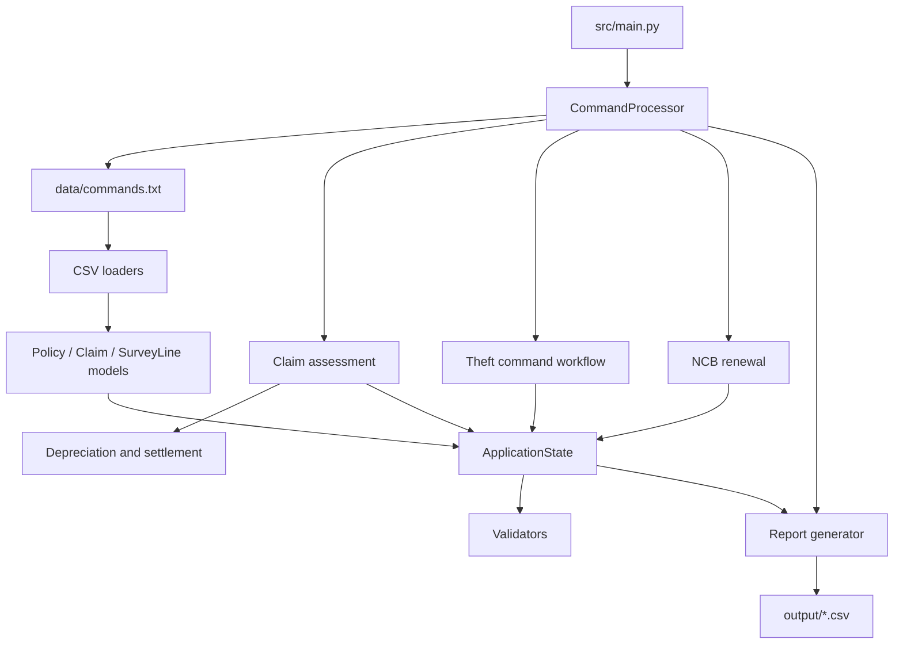

# System Design — Motor Insurance Claims Settlement System

## 1. Project overview and objectives

The PS-011 project is a Python command-driven motor-insurance claims
settlement application for Team T051. It loads policy, claim, and survey-line
data from CSV files, applies the implemented claim and renewal rules, and
writes claim, policy-history, and validation/error reports as CSV files.

The system's objectives, as evidenced by the implementation, are to:

- validate and retain policy, claim, and survey data;
- assess repair, total-loss, and theft claims using the configured rules;
- calculate policy-year NCB at renewal; and
- produce repeatable, tabular computation and history reports.

## 2. System architecture

The application separates command orchestration, data models and state,
validation, claim calculations, and report generation. `src/main.py` is the
entry point. `CommandProcessor` executes the command file in order and passes
shared `ApplicationState` through loaders and calculation functions.

The implemented theft command workflow is in `command_processor.py`; the
separate `theft.py` module also exposes theft eligibility and settlement
helpers. The command processor currently performs its command-level theft
handling in its own methods.

## 3. Python modules and responsibilities

| Module | Responsibility |
|---|---|
| `src/__init__.py` | Marks `src` as a Python package. |
| `src/main.py` | Resolves the project root, runs command processing, generates reports, prints execution totals, and returns a process status. |
| `src/command_processor.py` | Parses and executes commands in file order; invokes loaders, claim assessment, theft actions, and renewals; queues report requests and records command errors. |
| `src/models.py` | Defines the `Policy`, `Claim`, and `SurveyLine` dataclasses and their field types. |
| `src/state.py` | Holds loaded records, claim results, policy history, errors, and theft recovery dates in `ApplicationState`. |
| `src/constants.py` | Centralizes rates, thresholds, categories, add-ons, decisions, statuses, and other rule constants. |
| `src/rule_ids.py` | Defines BR-01 through BR-12 descriptions/order and formats rule identifiers. |
| `src/data_loader.py` | Parses policy, claim, and survey CSV rows into model instances and records row-level parsing errors. |
| `src/validators.py` | Validates loaded policies, claims, references, and survey lines; rejects invalid lines and exact duplicate survey entries. |
| `src/depreciation.py` | Computes completed vehicle age, part depreciation, payable part amounts, and two-decimal monetary rounding. |
| `src/settlement.py` | Calculates compulsory/total excess, line coverage, covered repair-line amounts, and repair settlement totals. |
| `src/claim_engine.py` | Coordinates non-theft claim checks, ZERO_DEP eligibility, total-loss detection, repair/total-loss settlement, and applied rule IDs. |
| `src/theft.py` | Provides theft FIR timing, waiting-period and recovery checks, RTI eligibility, and theft settlement helper functions. |
| `src/ncb.py` | Computes the next NCB slab, counts policy-period claims and ZERO_DEP usage, and records renewal NCB history. |
| `src/report_generator.py` | Builds and writes claim-line, claim-sheet, policy-history, and error CSV reports. |

## 4. Input data flow

1. `main()` creates a `CommandProcessor` using the project root. Its data
   directory is `data/` and its report directory is `output/`.
2. The processor opens `data/commands.txt`, ignoring blank lines and lines
   beginning with `#`, and executes remaining commands in their original
   order.
3. `LOAD_POLICIES`, `LOAD_CLAIMS`, and `LOAD_SURVEY` use `csv.DictReader` to
   parse the respective CSV files. Dates, timestamps, decimals, booleans,
   and add-ons are converted into Python values.
4. On `LOAD_SURVEY`, `validate_all()` checks all loaded records. Valid
   survey lines are grouped by `claim_id` in application state.
5. Later assessment, theft, renewal, and print commands operate on that
   shared state. Data-loading and validation errors are retained for the
   error report rather than silently discarded.

The field schemas and input validation details are documented in
[sample_data_README.md](./sample_data_README.md).

## 5. Claim assessment workflow

For a non-theft `ASSESS` command, the processor checks that the claim exists
and dispatches to `assess_claim()`. In sequence, the claim engine:

1. Confirms the claim's policy exists and the assessment date is not before
   the incident.
2. Calculates vehicle age from the purchase date to the incident date.
3. Rejects an intimation more than seven days after the incident; otherwise
   determines whether a delay deduction applies.
4. Validates the driving-licence status and expiry on the incident date.
5. Confirms the policy covers the incident date.
6. Determines whether ZERO_DEP is available, based on the add-on, vehicle age,
   and prior eligible claims in the policy year.
7. Sums all surveyed part and labour costs before depreciation to test the
   total-loss threshold.
8. Sends a total loss to the IDV/RTI settlement path; otherwise calculates
   covered repair lines and the repair settlement.
9. Stores the decision, calculations, line details, and applicable rule IDs
   in application state.

Rejected claims have zero payable line amounts. In a repair settlement,
uncovered lines are rejected individually while covered lines continue
through calculation.

## 6. Depreciation and settlement processing

`depreciation.py` uses completed calendar months and category-specific rates.
Paint is calculated using the metal rate on half its cost. Covered labour is
not depreciated; each line's calculated part depreciation and payable part
are rounded to two decimal places.

`settlement.py` calculates covered repair-line amounts and combines them with
payable labour. Repair GST is added for individual policyholders and omitted
for corporate holders. Excess, any applicable delay deduction, and the
learner cap follow in that order. The result is classified as `BELOW_THRESHOLD`
when it is less than Rs 500.00. The exact business-rule formulas and
boundaries are in [business_rules.md](./business_rules.md).

For total loss, the claim engine compares pre-depreciation surveyed repair
cost with 75% of IDV. Settlement is based on IDV or eligible invoice value,
then applies excess, any customer-retained salvage deduction, delay
deduction, and learner cap. It does not derive the total-loss payout from
depreciated repair lines.

## 7. Theft settlement workflow

The command processor keeps theft apart from ordinary `ASSESS` processing:

1. A theft FIR later than 24 hours after the incident creates a rejected
   claim result.
2. `THEFT_RECOVERED` records the recovery date. Recovery before FIR date plus
   90 days converts the claim to a repair assessment; recovery on or after
   that date does not.
3. `SETTLE_THEFT` before the eligibility date logs a premature command and
   leaves settlement pending. On or after the date, it calculates IDV less
   excess, or invoice value less excess when RTI applies.

The theft settlement route does not use repair-part depreciation, repair GST,
or the repair minimum-settlement threshold. Details and boundary conditions
are in BR-08 and BR-09 of [business_rules.md](./business_rules.md).

## 8. NCB and policy renewal workflow

`RENEW` invokes `process_ncb_renewal()` using the expiring policy dates.
Assessed claims are counted by incident date within that inclusive policy
period; rejected and unassessed claims are excluded, and `BELOW_THRESHOLD`
claims are included. NCB advances one slab with no counted claims, retains
its current value for one claim protected by NCB_PROTECT, and resets to zero
for an unprotected claim or more than one claim. The processor records the
old period and NCB values in history, then changes the policy period to start
on the renewal date and end 12 calendar months later minus one day.

## 9. Report generation

After command processing, `report_generator.py` writes UTF-8-with-BOM CSVs
under `output/`:

| Report | Contents |
|---|---|
| `claim_lines.csv` | Calculated line details for assessed claims, ordered by claim and line ID. |
| `claim_sheet.csv` | A computation row for each valid queued `PRINT_CLAIM_SHEET` command. |
| `policy_history.csv` | A history row for each valid queued `PRINT_POLICY_HISTORY` command. |
| `errors.csv` | Recorded loader, validation, and command errors. |

Print commands are queued while the command stream is processed; the report
generator uses that log to decide which claim sheets and policy histories to
write.

## 10. Error handling

- CSV parsing errors are recorded with their source, row, reference ID, and
  reason. Policy, claim, and survey validation errors are added to shared
  application state.
- Invalid commands, unknown IDs, and failures during assessment, theft
  handling, or renewal are recorded as command errors and processing can
  continue.
- Missing command files and other failures escaping command processing are
  reported by `main()` as project execution failures and return a non-zero
  process status.
- Errors are emitted in `output/errors.csv`. The supplied integration tests
  assert two errors for the sample command/data pack.

## 11. Technologies and libraries

- **Python** is the implementation language.
- **Python standard library:** `csv`, `dataclasses`, `datetime`, `decimal`,
  `pathlib`, `inspect`, `calendar`, and `sys` support parsing, data models,
  dates, monetary arithmetic, filesystem paths, command dispatch, and process
  status.
- **pytest** is listed in `requirements.txt` and is used by the automated
  test suite.

No external runtime calculation or web service dependency is declared.